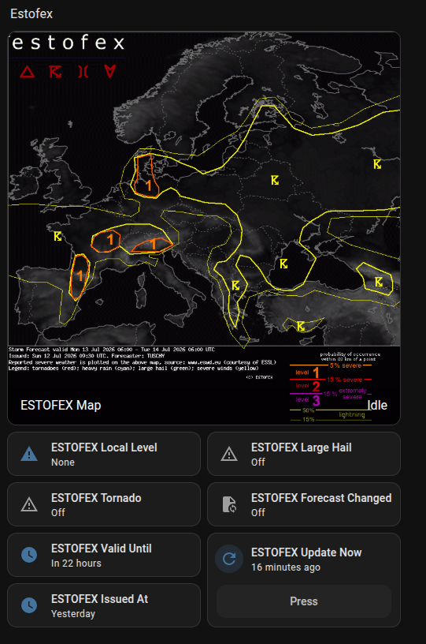

# ESTOFEX for Home Assistant

Monitor ESTOFEX convective forecasts in Home Assistant, display the latest forecast map, and expose structured warning information for dashboards, automations, and notifications.

ESTOFEX is the European Storm Forecast Experiment. This custom integration polls public ESTOFEX forecast data, caches the current map locally, parses forecast metadata and discussion text, and evaluates whether the configured Home Assistant location is inside an ESTOFEX warning polygon.

> This integration is not affiliated with ESTOFEX. Forecast data is provided by ESTOFEX.

The current release is [v0.4.0](https://github.com/MysterX83/ha-estofex/releases/tag/v0.4.0).

## Screenshots

### Home Assistant dashboard



## Features

- Setup through the Home Assistant UI
- Hourly polling through `DataUpdateCoordinator`
- Manual refresh button
- Latest ESTOFEX forecast map as a camera entity
- Locally cached map at `/local/estofex/latest.png`
- Built-in placeholder map when there is no active forecast
- Forecast metadata sensors
- Original ESTOFEX discussion parsing
- Dutch translation and summary hooks (no provider is included in v0.4.0)
- Polygon parsing from ESTOFEX XML source
- Local warning detection using Home Assistant latitude/longitude
- Hazard binary sensors for hail, wind, rain, tornado, and flash flooding
- Home Assistant events for forecast and local warning transitions
- Diagnostics support

## Installation

### HACS

Until the repository is accepted as a default HACS repository, install it as a custom repository:

1. Open HACS in Home Assistant.
2. Go to **Integrations**.
3. Open the three-dot menu and choose **Custom repositories**.
4. Add this repository URL:

   ```text
   https://github.com/MysterX83/ha-estofex
   ```

5. Select category **Integration**.
6. Install **ESTOFEX**.
7. Restart Home Assistant.
8. Add the integration from **Settings > Devices & services > Add integration > ESTOFEX**.

### Manual Installation

Copy:

```text
custom_components/estofex
```

to:

```text
/config/custom_components/estofex
```

Restart Home Assistant, then add the integration from:

```text
Settings > Devices & services > Add integration > ESTOFEX
```

## Configuration

No YAML configuration is required.

The integration uses:

- Home Assistant's configured latitude and longitude for local warning detection
- ESTOFEX public forecast data
- A one-hour polling interval

Only one ESTOFEX config entry is currently supported.

To remove the integration, delete the ESTOFEX config entry from **Settings -> Devices & services**, restart Home Assistant if prompted, and remove `custom_components/estofex` if you installed it manually.

## Entities

Entity IDs can vary if Home Assistant has already created entities with the same names.

### Camera

| Entity | Description |
| --- | --- |
| `camera.estofex_map` | Latest cached ESTOFEX forecast map |

### Sensors

| Entity | Description |
| --- | --- |
| `sensor.estofex_forecast_id` | Latest ESTOFEX forecast file ID |
| `sensor.estofex_issued_at` | Forecast issue timestamp |
| `sensor.estofex_valid_until` | Forecast valid-until timestamp |
| `sensor.estofex_forecast_number` | ESTOFEX forecast number |
| `sensor.estofex_map_url` | Local cached map URL |
| `sensor.estofex_local_level` | Highest warning level for the Home Assistant location |
| `sensor.estofex_local_summary` | Concise local warning summary |
| `sensor.estofex_discussion` | Original ESTOFEX discussion state with text attributes |
| `sensor.estofex_summary_nl` | Dutch summary availability and text |
| `sensor.estofex_discussion_nl` | Dutch translation availability and text |
| `sensor.estofex_status` | Update status |
| `sensor.estofex_last_checked` | Last update attempt |
| `sensor.estofex_last_successful_update` | Last successful forecast/map update |
| `sensor.estofex_last_changed` | Last detected forecast change |
| `sensor.estofex_image_downloaded` | Whether the last cycle downloaded an image |
| `sensor.estofex_http_status` | Last HTTP status diagnostics |

### Binary Sensors

| Entity | Description |
| --- | --- |
| `binary_sensor.estofex_local_warning` | On when Home Assistant location is inside a parsed ESTOFEX polygon |
| `binary_sensor.estofex_forecast_changed` | On immediately after a new forecast is detected |
| `binary_sensor.estofex_large_hail` | Local warning includes large hail |
| `binary_sensor.estofex_severe_wind` | Local warning includes severe wind gusts |
| `binary_sensor.estofex_excessive_rain` | Local warning includes heavy or excessive rainfall |
| `binary_sensor.estofex_tornado` | Local warning includes tornado risk |
| `binary_sensor.estofex_flash_flood` | Local warning includes flash flooding |

### Button

| Entity | Description |
| --- | --- |
| `button.estofex_update_now` | Requests an immediate coordinator refresh |

## Status Values

| Status | Meaning |
| --- | --- |
| `OK` | Forecast data is available |
| `Updating` | Coordinator is currently refreshing |
| `No forecast` | ESTOFEX is reachable, but no active storm forecast was found, or the latest listed forecast has expired |
| `Offline` | ESTOFEX is temporarily unreachable; previous data is preserved when available |
| `Error` | Unexpected integration error |

## Events

The integration fires these Home Assistant events:

### `estofex_forecast_updated`

Fired when a new ESTOFEX forecast ID is detected.

Payload:

```yaml
forecast_id: string
issued_at: string | null
valid_until: string | null
levels_present: list
hazards: list
local_warning: boolean
```

### `estofex_warning_started`

Fired when the configured Home Assistant location enters an ESTOFEX warning polygon.

### `estofex_warning_cleared`

Fired when the configured Home Assistant location is no longer inside an ESTOFEX warning polygon.

Payload:

```yaml
forecast_id: string | null
issued_at: string | null
valid_until: string | null
level: string | null
hazards: list
local_warning: boolean
```

## Dashboard Examples

### Picture Entity Card

```yaml
type: picture-entity
entity: camera.estofex_map
show_name: false
show_state: false
```

### Local Warning Entities

```yaml
type: entities
entities:
  - binary_sensor.estofex_local_warning
  - sensor.estofex_local_level
  - sensor.estofex_local_summary
  - binary_sensor.estofex_large_hail
  - binary_sensor.estofex_severe_wind
  - binary_sensor.estofex_excessive_rain
  - binary_sensor.estofex_tornado
  - binary_sensor.estofex_flash_flood
```

### Diagnostics Entities

```yaml
type: entities
entities:
  - button.estofex_update_now
  - sensor.estofex_status
  - sensor.estofex_last_checked
  - sensor.estofex_last_successful_update
  - sensor.estofex_last_changed
  - sensor.estofex_http_status
```

## Troubleshooting

### The camera shows the placeholder map

- Check `sensor.estofex_status`.
- If the status is `No forecast`, ESTOFEX currently has no active forecast and the cached map is intentionally removed. The camera stays available and shows the bundled placeholder image.
- If the status is `Offline`, ESTOFEX could not be reached. Existing data is preserved when available.

### Local warning never turns on

- Verify Home Assistant's configured latitude and longitude.
- Confirm the current ESTOFEX map has polygons over your location.
- Check `sensor.estofex_local_level` and `sensor.estofex_local_summary`.

### Forecast discussion is available but Dutch sensors are unavailable

This is expected. The Dutch translation and summary hooks are present, but no external AI provider is included or required in v0.4.0.

### Manual update does not appear to download a new map

The integration only downloads the map when the ESTOFEX forecast ID changes, or when the cached map is missing. This avoids unnecessary network traffic.

## Diagnostics

Home Assistant diagnostics include:

- forecast ID
- forecast number
- status
- timestamps
- source URL
- HTTP status values
- update duration
- download size
- parser version
- polygon count
- parsed hazard types
- local warning state

Diagnostics do not include credentials, API keys, or secrets. The integration currently has no user-provided credentials.

Diagnostics intentionally omit Home Assistant latitude/longitude and local filesystem paths. Public ESTOFEX source URLs may be included because they identify which public bulletin was parsed.

## Architecture

The integration is split into small modules:

| Module | Responsibility |
| --- | --- |
| `api.py` | ESTOFEX HTTP client and response handling |
| `parser.py` | Forecast list, XML, HTML, discussion, level, polygon, and hazard parsing |
| `models.py` | Dataclasses for forecasts, hazards, polygons, discussions, diagnostics, and update results |
| `geometry.py` | Point-in-polygon and local warning evaluation |
| `coordinator.py` | Refresh orchestration, cache policy, status, events, and diagnostics state |
| `entity.py` | Shared Home Assistant entity base |
| `sensor.py` | Sensor entities |
| `binary_sensor.py` | Binary sensor entities |
| `camera.py` | Cached map camera entity |
| `button.py` | Manual refresh button |
| `translator.py` | Optional translation and summary abstraction |
| `diagnostics.py` | Home Assistant diagnostics output |
| `exceptions.py` | Domain-specific exceptions |

Entities do not make HTTP requests and do not parse ESTOFEX data. They only read coordinator data.

### Update Flow

1. The coordinator fetches the ESTOFEX forecast list every hour, or when the update button is pressed.
2. If no active forecast is listed, or the listed forecast has expired, the cached map is removed and the camera serves the bundled no-forecast placeholder.
3. If the forecast ID is unchanged, parsed data is reused and the cached map is only re-downloaded when missing.
4. If a new forecast is found, the XML source is parsed, the map is downloaded, local warning polygons are evaluated, and transition events are fired.
5. If ESTOFEX is temporarily unreachable, the previous valid forecast is preserved when available and the status changes to `Offline`.

## Known Limitations

- ESTOFEX forecasts are not official weather warnings.
- Only one config entry is supported.
- Dutch translation and summary sensors remain unavailable because v0.4.0 does not include a provider.
- Mesoscale Discussions, LightningMaps, KNMI, DWD, ESWD, and a custom Lovelace card are not included in v0.4.0.
- Hazard-to-region mapping is best-effort and depends on the structure of the public ESTOFEX bulletin text.

## Roadmap

### v0.5

- Optional AI-backed Dutch summaries
- Optional AI-backed Dutch discussion translation
- Mesoscale Discussion parsing
- Improved hazard-to-region mapping
- More complete tests with mocked ESTOFEX responses

### Later

- LightningMaps integration
- ESWD event correlation
- KNMI warning context
- DWD warning context
- Region filters
- Custom Lovelace card
- Notification blueprints

## FAQ

### Is AI required?

No. The integration works without AI and makes no AI network calls in v0.4.0.

### Does this replace official weather warnings?

No. ESTOFEX is a convective forecast product. Use official national meteorological services for operational warnings.

### Why does the integration keep old data when ESTOFEX is offline?

Temporary ESTOFEX outages should not erase useful existing data. The status changes to `Offline` while the previous forecast remains available when possible.

### Why is the map removed when there is no forecast?

When ESTOFEX is reachable and reports no active forecast, an old map would be misleading. The cached map is removed and the camera shows a bundled no-forecast placeholder until a new forecast is published.

## Contributing

Contributions are welcome. See [CONTRIBUTING.md](CONTRIBUTING.md) for development guidance and required checks.

## License

This project is licensed under the MIT License. See [LICENSE](LICENSE).
