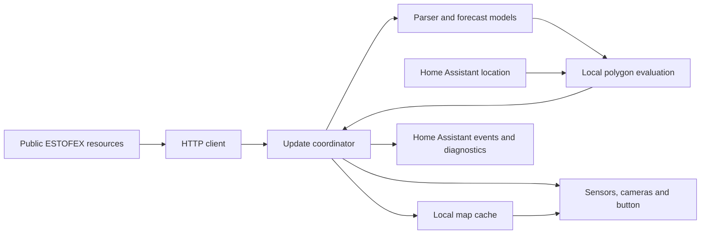
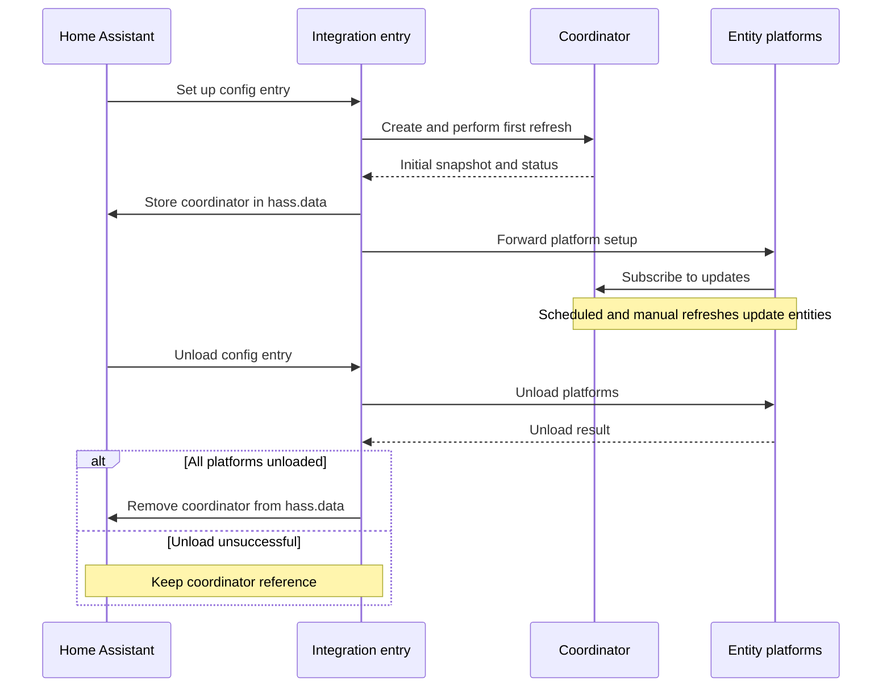

# Architecture

[Documentation index](../README.md) · [System overview](overview.md)

## System structure

The coordinator owns refresh scheduling and assembles one immutable update result.
The HTTP client handles transport. Parsing and geometry transform input without
making network requests. Entities expose coordinator state; cameras read cached
images and the button requests a refresh.

## Design decisions

| Decision | Reason and consequence |
| --- | --- |
| One shared coordinator | Entities see the same update result and do not independently poll ESTOFEX |
| Separate transport, parser and geometry | Upstream format changes and geographic edge cases can be tested independently |
| Immutable dataclasses | Updates produce snapshots rather than partially mutating entity-visible data |
| Multiple forecasts with one primary | Preserve the existing primary interface while combining overlapping local risks |
| Local image cache | Cameras need no ESTOFEX request when Home Assistant asks for an image |
| Distinguish empty data from failure | A temporary error must not masquerade as an authoritative end to a warning |
| Separate unit and framework tests | Fast stub-based tests remain usable while real Home Assistant validates lifecycle behavior |

## Lifecycle and ownership

The config flow creates one empty configuration entry. Setup creates a coordinator,
performs its first refresh, stores it under `hass.data["estofex"][entry_id]`, and
forwards setup to sensor, binary sensor, camera and button platforms. Unload removes
platforms and, on success, the coordinator reference.

Home Assistant owns the shared HTTP session and scheduling. The integration owns
its in-memory forecast snapshots and map cache files. Blocking map I/O is delegated
to Home Assistant executor jobs. There is no persisted forecast database.

### Entry lifecycle

The first snapshot can represent an error or an empty forecast set; receiving a
snapshot does not necessarily mean ESTOFEX is reachable. Reload follows unload
with a fresh setup, while map files remain available for reuse.

## Change boundaries

Add upstream request behavior in the API client, source recognition in the parser,
and location mathematics in geometry. Keep refresh policy, caching decisions and
event transitions in the coordinator. New entities should consume existing models
or deliberately extend their contract rather than parse raw source themselves.

See [components and data](../low-level/components-and-data.md) for source locations
and [runtime behavior](../low-level/runtime.md) for the update sequence.
