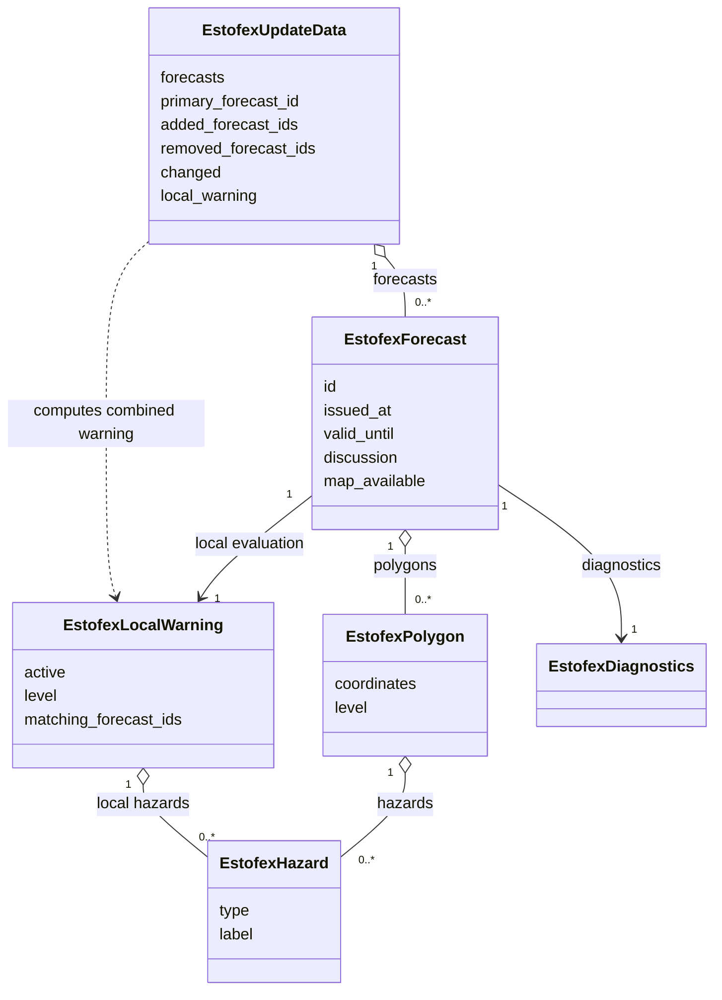

# Components and data

[Documentation index](../README.md) · [Runtime behavior](runtime.md)

## Source map

All runtime modules are under [custom_components/estofex](../../custom_components/estofex).

| Module | Responsibility |
| --- | --- |
| [__init__.py](../../custom_components/estofex/__init__.py), [config_flow.py](../../custom_components/estofex/config_flow.py) | Entry setup/unload and single-instance configuration |
| [api.py](../../custom_components/estofex/api.py) | Shared aiohttp session, request URLs, text/byte response metadata and connection errors |
| [parser.py](../../custom_components/estofex/parser.py) | List discovery, XML-like/HTML parsing, text sanitization and hazard extraction |
| [models.py](../../custom_components/estofex/models.py) | Immutable forecast snapshots and combined warning properties |
| [geometry.py](../../custom_components/estofex/geometry.py) | Point-in-polygon and local hazard selection |
| [coordinator.py](../../custom_components/estofex/coordinator.py) | Refresh, error policy, enrichment, cache synchronization and events |
| [map_cache.py](../../custom_components/estofex/map_cache.py) | Safe filenames and removal of integration-owned maps |
| [entity.py](../../custom_components/estofex/entity.py) | Shared entity base |
| [sensor.py](../../custom_components/estofex/sensor.py), [binary_sensor.py](../../custom_components/estofex/binary_sensor.py) | Primary metadata and combined local warning state |
| [camera.py](../../custom_components/estofex/camera.py), [button.py](../../custom_components/estofex/button.py) | Cached images, dynamic forecast cameras and refresh request |
| [translator.py](../../custom_components/estofex/translator.py) | Optional translation/summary hooks; currently return `None` |
| [diagnostics.py](../../custom_components/estofex/diagnostics.py) | Export of selected runtime diagnostics |
| [const.py](../../custom_components/estofex/const.py), [exceptions.py](../../custom_components/estofex/exceptions.py) | Shared constants and domain errors |

## Core data contracts

| Model | Meaning |
| --- | --- |
| `EstofexForecastReference` | Forecast ID and list-derived issue/expiry times used for preliminary activity filtering |
| `EstofexForecast` | Parsed metadata, discussion, polygons, hazards, map references and local evaluation for one forecast |
| `EstofexPolygon` | Coordinates as `(latitude, longitude)` pairs, level and associated hazards |
| `EstofexLocalWarning` | Matching state, strongest level/polygon, deduplicated hazards and matching forecast IDs |
| `EstofexUpdateData` | Ordered active forecasts, primary ID, added/removed IDs and change flag |
| `EstofexDiagnostics` | Per-forecast snapshot of update measurements |

The diagram shows the central snapshot relationships. The combined warning on
`EstofexUpdateData` is computed from its forecasts, rather than stored separately.

Dataclasses are frozen and use tuples for collections. Use `dataclasses.replace`
when enriching a snapshot. `EstofexUpdateData` sorts forecasts by issue time and
then ID, newest first; if its primary ID is absent or invalid, it selects the first
forecast. Empty data has no primary forecast.

Activity requires an expiry time strictly after `now`, with an issue time that is
absent or no later than `now`. Comparisons normalize to UTC. The current activity
check uses issue time, not `valid_from`, as its lower bound.

## Parsing contract

`parse_forecast_entries()` discovers storm forecast filenames and derives their
times. If it finds no entries, it accepts an empty result only when the source has
a complete table and the normalized headings `forecast threat level period
forecaster`. Other empty/error responses raise `EstofexParseError`.

`parse_estofex_forecast()` selects the XML-like path when a `<forecast>` opening
tag is present. It requires a closing tag and parseable issue/expiry attributes.
A valid forecast without risk areas is allowed. The HTML path requires issue and
validity metadata. A filename alone cannot make an invalid source valid.

Discussion text is normalized and sanitized before exposure. Long discussion text
is placed in attributes; sensor state only indicates availability. Markdown is
derived from normalized discussion text. Hazard extraction uses text patterns;
it does not provide a precise geographic interpretation of every sentence.

## Geometry and aggregation

`point_in_polygon()` uses ray casting, counts boundary points as inside and rejects
polygons with fewer than three vertices. Longitudes are normalized and consecutive
edges unwrapped across the date line; the query point is shifted into the same
longitude range. This is planar polygon evaluation, not a geodesic model.

Within one forecast, the highest numeric level wins, with hazard count as a tie
breaker. Hazards from all matching polygons are deduplicated by type. Across
forecasts, `EstofexUpdateData.local_warning` applies the same strongest-warning
selection and unions local hazards. `thunderstorm_risk` specifically requires a
local level 1, 2 or 3 match; a general local polygon match is a broader condition.

## Public contracts

Keep entity names, discussion compatibility aliases and event fields compatible
with existing dashboards and automations. The [README](../../README.md#entities)
contains the public reference; source methods `_forecast_event_payload()` and
`_warning_event_payload()` define the actual event dictionaries. Warning payloads
also include `active_forecast_ids` and `primary_forecast_id`.
