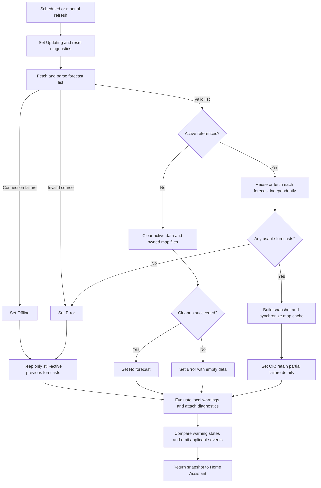
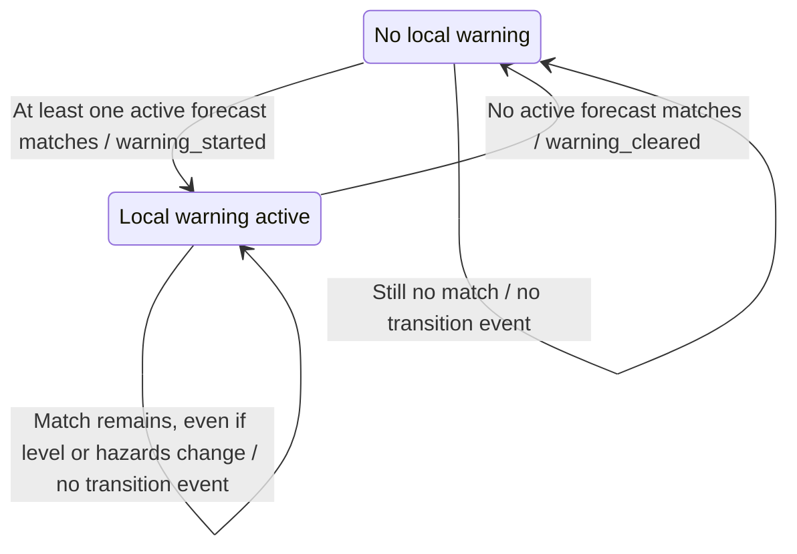

# Runtime behavior

[Documentation index](../README.md) · [Components and data](components-and-data.md)

## Refresh sequence

`EstofexCoordinator._async_update_data()` captures previous data and UTC time,
resets per-cycle diagnostics and announces `Updating`.

1. Fetch and parse the forecast list, then filter references by activity.
2. If no reference is active, clear active data and integration-owned maps.
3. For each active reference, reuse an existing active parsed forecast or fetch
   and parse its source. If discussion is missing, try the HTML page. Run the
   translation/summary hooks and ensure the individual map is cached.
4. Isolate expected connection, parse and filesystem failures per forecast so
   other usable forecasts can continue.
5. Build ordered update data, compare IDs and primary selection with the previous
   snapshot, then synchronize map files and the primary alias.
6. Evaluate each forecast against the configured location, attach diagnostics,
   fire transition events and return the new snapshot to Home Assistant.

The HTTP client uses a 20-second timeout per request. HTTP status 400 and above,
aiohttp errors and timeouts become `EstofexConnectionError`. Requests are not
retried in a tight loop; a later scheduled or manual refresh attempts recovery.

### Refresh decision flow

Expected per-forecast failures are isolated inside the load step. Unexpected
exceptions from the refresh path also enter the `Error` fallback. The table below
describes cases such as partial success and map failures in more detail.

## Failure and status policy

| Situation | Result |
| --- | --- |
| Usable forecasts assembled | `OK`; partial failures can still be recorded in `last_error` |
| Recognized list has no active references | `No forecast`; active data and owned map files are cleared |
| List request fails with a connection error | `Offline`; retain only still-active previous forecasts |
| List is invalid or an unexpected update exception occurs | `Error`; retain only still-active previous forecasts |
| No listed forecast can be used | `Error`; reuse still-active previous data if available |
| Discussion or map fetch fails | Forecast metadata can remain usable; log/store the failure |
| Cache cleanup fails in the no-forecast path | `Error`, with empty active data |

An `OK` status is not proof that every image or discussion download succeeded.
Inspect diagnostics and logs when investigating partial failures.

Expiry filtering runs on refresh. There is no dedicated expiry timer, so state
can remain unchanged between the validity boundary and the next update. Failure
handlers do not synchronize or delete cache files: an old `/local/estofex/latest.png`
can remain on disk even after active data expires. The primary camera checks active
map availability and falls back to its placeholder when no active map exists.

## Cache behavior

Files live under `<config>/www/estofex/`. Individual names use
`forecast_<safe-id>.png`; unsafe characters are replaced, IDs are length-limited,
and transformed IDs receive a short SHA-256 suffix. `latest.png` mirrors the primary
map and is copied only if bytes differ.

A forecast map is downloaded when its individual file is missing. Parsed data is
reused by forecast ID while active, so upstream content changes under the same ID
are not automatically reparsed on every poll. Reload creates a new coordinator and
refetches metadata, while existing image files can be reused.

Successful synchronization deletes inactive `forecast_*.png` files and updates or
removes `latest.png`. A recognized no-forecast result clears both. Cleanup leaves
unrelated files alone. Unloading the entry is not a cache purge.

## Events and entity lifecycle

`estofex_forecast_updated` fires when the returned update has `changed=True`,
normally after added/removed IDs or a different primary forecast. Identical polls
do not emit it. Failure fallback snapshots leave this flag false, including when
expiry filtering removes forecasts; consumers should not treat this event as an
exhaustive record of expiry during outages.

`estofex_warning_started` and `estofex_warning_cleared` compare the previous and
current combined warning booleans. A level or hazard change while warning remains
active does not emit either transition. A warning is not cleared while another
active forecast still matches. Clearing payloads describe current data, not a
copy of the warning that ended.

### Combined warning transitions

Labels abbreviate the `estofex_` event prefix. These transitions are evaluated
when a refresh returns its snapshot, including after failure fallback and expiry
filtering. Forecast-set change events are evaluated separately.

The camera platform keeps a primary camera and synchronizes dynamic forecast
cameras as the active set changes. Removed forecast cameras are removed from both
Home Assistant state and the entity registry. Other platforms read coordinator
snapshots. Setup and unload are implemented in the integration entry module.

## Troubleshooting entry points

Start with status, last-checked/last-successful timestamps and Home Assistant
integration diagnostics. For source errors inspect parser behavior and fixtures;
for a wrong local match inspect coordinates, parsed polygons and geometry; for a
stale image inspect cache policy and camera selection. Do not add precise home
coordinates, private paths or secrets to exported diagnostics.
